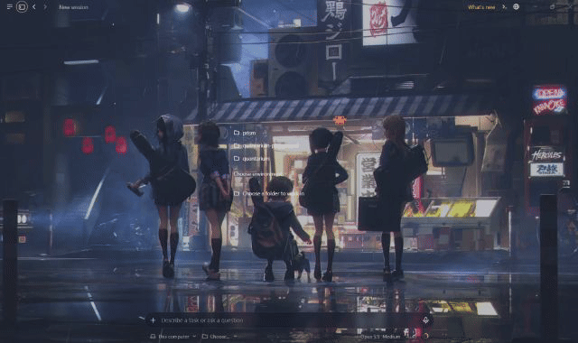
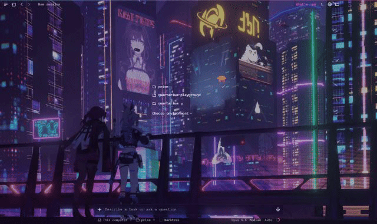
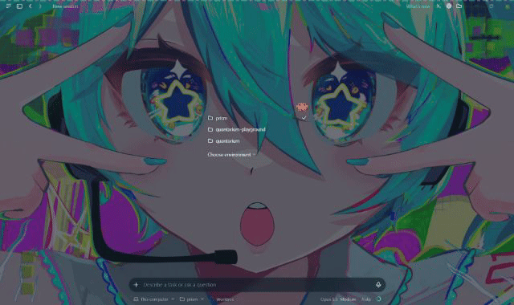

# Prism Themes

Prism has two desktop integrations:

- **[ChatGPT/Codex on Windows](platforms/chatgpt-windows/README.md):** local image and looping video wallpapers, with matching translucent panels, accent colour, font and corner shape. This engineering preview is verified in the Codex view of the `OpenAI.Codex` Windows app.
- **Claude Desktop:** colours, fonts, corner shapes, and picture, slideshow or video backgrounds for the Code tab. Themes can follow light/dark mode, inherit from each other, and switch by project folder or time of day.

The integrations have different installation steps and theme formats. Wallpaper Engine `.mp4` files work in both.

A community mod, not made or endorsed by Anthropic or OpenAI. The Claude integration grew out of
[claude-desktop-themes](https://github.com/0toshigami/claude-desktop-themes) by 0toshigami, whose idea of painting
the app through its React DevTools extension slot it builds on.

> **Unofficial.** Both integrations use app internals that can change after an update. The Codex integration checks
> unfamiliar builds in an isolated profile; on Claude Desktop, Prism tells you when an update breaks part of it (see
> [When an update breaks something](#when-an-update-breaks-something)).

## Claude Desktop demos

| Afterschool Rain | Punklorde | Miku |
| :-: | :-: | :-: |
|  |  |  |
| a video wallpaper, frosted panels | neon effects that react while Claude works | light and dark palettes |

The backgrounds are Wallpaper Engine wallpapers by their own creators, not part of Prism:
[K-ON RAIN LIVE WALLPAPER](https://steamcommunity.com/sharedfiles/filedetails/?id=2406625656),
[Punklorde (desktop resolution)](https://steamcommunity.com/sharedfiles/filedetails/?id=3422072291) and
[初音-AniLuoty](https://steamcommunity.com/sharedfiles/filedetails/?id=3702521609) on the Steam Workshop.
Prism ships none of them; you point a theme at a file you already have.

## Codex on Windows

The [Codex implementation](platforms/chatgpt-windows/README.md) applies a local image or muted looping MP4/WebM to the regular signed-in Windows app. It samples a matching theme, then lets you adjust the font, panel tint, accent, opacity and corners. These are saved together with the wallpaper and can be restored by name. It does not use Claude's JSON theme files.

Install Node.js 22 or later, then from `platforms/chatgpt-windows` run:

```powershell
powershell.exe -NoProfile -ExecutionPolicy Bypass -File .\Install.ps1
```

Fully quit ChatGPT/Codex, including its tray process, and reopen it. Select Prism from the composer's slash list. For example, with your own copy of the [Miku wallpaper](https://steamcommunity.com/sharedfiles/filedetails/?id=3702521609):

```text
/prism bg "C:\path\to\初音.mp4"
```

Tailor and save a theme with `/prism dim`, `/prism theme tint`, `/prism theme accent`, `/prism theme font`, `/prism theme opacity`, `/prism theme radius`, and `/prism theme save`. The complete [Miku Starlight recipe](platforms/chatgpt-windows/README.md#miku-starlight-example) shows values that work with this video. After saving it, `/prism theme use "Miku Starlight"` restores the combination. Prism keeps the media in a local store; this repository does not include the wallpaper.

The Windows integration registers a current-user helper and a package debug callback. Its [setup and limits](platforms/chatgpt-windows/docs/preview-readme.md) explain the local debugging endpoint, compatibility check and removal path. The separately managed image-only prototype remains documented in the platform README.

## Install for Claude Desktop

At the prompt of a Claude Code terminal session:

```
/plugin install prism-themes --marketplace f1ymango/prism-themes
```

From a shell:

```bash
claude plugin install prism-themes --marketplace f1ymango/prism-themes
```

In the desktop app, where `/plugin` does not run: click + next to the prompt box, then Plugins, Add marketplace
with `f1ymango/prism-themes`, then Add plugin.

Then, in a Code session in Claude Desktop:

1. Type `/prism`. A strip opens above the prompt.
2. For full themes, press **Install extension**, then quit Claude Desktop fully (Windows: also from the system
   tray; macOS: Cmd+Q) and open it again.
3. Pick a theme. **Claude** returns to the app's own look.

## How it draws

| | Official backdrop | Extension (optional) |
| --- | --- | --- |
| How | Claude Code's own `$.theme.set` mod API (`$.ui.backdrop` before 2.1.321) | a content script in the app's React DevTools extension slot, loaded when `REACT_PROFILE=1` |
| What | gradient backgrounds, frosted panels | colours, fonts, corners, reactions; picture, slideshow, SVG and video backgrounds |
| Needs | an app version that draws backdrops | one install and a restart |

Prism uses the official API where the app supports it and the extension elsewhere, and says which in the strip.

## Commands

| Command | What it does |
| --- | --- |
| `/prism` | open or close the theme strip |
| `/prism use <id>` | switch theme for this session |
| `/prism bg <file or folder>` | your own background: a picture, an animated SVG, a video, a folder of pictures (a slideshow), or a folder holding one video (a Wallpaper Engine wallpaper) |
| `/prism bg off` | back to the theme's own background |
| `/prism set` | list every adjustable part, its value and its range (see below) |
| `/prism set <key> <value>` | change one, e.g. `/prism set panels.blur 0` |
| `/prism reset <key>`, `/prism reset all` | back to the defaults |
| `/prism remove <id>` | remove one of your themes: its file and its own stylesheet move to `prism-themes\removed\` |
| `/prism restore`, `/prism restore <id>` | list removed themes, or bring one back |
| `/prism reload` | re-read your themes folder |
| `/prism import <folder>` | import themes made for claude-desktop-themes |
| `/prism doctor` | what Prism found: what is broken and since which Claude Code version, the app's data folder, both drawing paths, your themes and their problems, the rule in force |

Files are judged by their content, not their name, with size limits of 15 MB per picture, 2 MB per SVG and 50 MB
per video.

### Settings

They apply on top of whichever theme is on, and stay when you switch themes.

| Key | Range | Default | What it changes |
| --- | --- | --- | --- |
| `panels.style` | glass, clear, solid | glass | side panels over a background |
| `panels.tint` | 0–0.9 | 0.4 | how strongly glass panels are tinted (lower is clearer) |
| `panels.blur` | 0–40 px | 14 | blur behind glass panels (0 is crisp) |
| `composer.tint` | 0–0.9 | 0.6 | tint of the box you type in, over a background |
| `composer.blur` | 0–40 px | 10 | blur behind the box you type in |
| `background.dim` | 0–0.9 | the theme's | veil over a picture or video background |
| `background.fit` | cover, contain | the theme's | fill the window, or show the whole picture |
| `background.interval` | 5–3600 s | the theme's | seconds per picture in a slideshow |
| `text.halo` | 0–20 px | 8 | glow around text over a background (0 turns it off) |
| `reactions` | on, off | on | composer glow while a tool runs, shake on errors, edge glow while waiting |

Shortcuts: `/prism glass`, `blur`, `panels`, `dim`, `fit` and `every` set `panels.tint`, `panels.blur`,
`panels.style`, `background.dim`, `background.fit` and `background.interval`. For crisp panels like a sheet of
tinted glass: `/prism set panels.blur 0` and `/prism set panels.tint 0.55`.

## Your own themes

Ask Claude to "make me a theme". The `make-theme` skill asks what you want, drafts a preview, and writes the theme
after you approve it. Or write one yourself: a theme is a JSON file in

- Windows: `%USERPROFILE%\.claude\prism-themes\themes\<id>.json`
- macOS: `~/.claude/prism-themes/themes/<id>.json`

```json
{
  "schema": 2,
  "id": "night-market",
  "name": "Night Market",
  "extends": "dusk",
  "palette": {
    "light": { "bg": "#f6f1e7", "text": "#2a2622", "accent": "#b4471f" },
    "dark": { "bg": "#151a2e", "text": "#efe9df", "accent": "#ff9a4d" }
  },
  "shape": { "radius": 10, "composerRadius": 20 },
  "background": { "file": "lanterns.mp4", "dim": 0.3 },
  "panels": "glass",
  "status": { "idle": "🏮", "tool": "🏮 {tool}…", "error": "🏮 {tool} failed", "done": "🏮 done" }
}
```

The full format, with stylesheets and the attributes they can react to, is in
[skills/make-theme/SKILL.md](skills/make-theme/SKILL.md). [examples/](examples/) has a light/dark theme and a
`rules.json` that picks themes by project folder and time of day (it goes in `.claude\prism-themes\`).

Secondary and muted text always keep a WCAG AA contrast (4.5:1) against the theme's background, whatever the palette.

To remove a theme of yours, run `/prism remove <id>`. Nothing is deleted outright: the theme file and its stylesheet
move to `.claude\prism-themes\removed\<id>~<date-time>\`, and `/prism restore <id>` puts them back. To remove a
theme for good, delete that folder. A few things are refused or left alone:

- Built-in themes can't be removed.
- A theme that another theme `extends` can't be removed until that other theme is removed or changed.
- A stylesheet that another theme also uses stays in place.
- A background file beside the theme stays in place. A background anywhere else, such as a Wallpaper Engine folder,
  is never touched.

If the removed theme was on, Prism switches to what your rules pick, or to Claude's own look.

## When an update breaks something

Claude Code and Claude Desktop update often, and Prism leans on parts of both that can change. After an update the
theme already on screen usually stays, because the page keeps the last one it was given. So a break used to show
only when switching themes quietly did nothing. Now:

- Each part of Prism (finding the app, reading your themes, applying a theme, the extension, reactions) runs on its
  own. A part that fails is recorded under its name, and the rest still start.
- When a part fails, a toast says which one. If Claude Code was updated since Prism last started without errors, the
  toast says that too, with both version numbers.
- The `/prism` strip shows a red **Not working** line, and `/prism doctor` has a **Health** section with the error
  itself.
- With the extension installed, a small notice also appears at the bottom of the window, even when the mod could not
  apply anything. The page also warns on its own when it can no longer find Claude's prompt box, which means Claude
  Desktop changed its layout.
- A failure that has a fallback is listed in the doctor as a note and raises no alert. The official backdrop is one:
  when it fails, the extension draws the background instead.

## Remove

Press **Remove extension** in `/prism`, then restart Claude Desktop. This undoes exactly what the install did: its
files, its manifest entries, and `REACT_PROFILE` only if the install was the one that set it. Another extension in
the same slot is left alone. Then uninstall the plugin (Settings → Plugins, or `claude plugin uninstall
prism-themes`). Your themes folder stays.

## Safety

- The extension runs only on `https://claude.ai/*`, top frame, and applies data the mod wrote.
- Stylesheets may not load anything from outside the page: no `@import`, no `url()` but `data:`, no CSS escapes.
- Background files are copied into the extension folder and shown as page elements, never through CSS.
- Nothing is fetched from the network.

## Known limits

- The Terminal and Browser panes keep their own backgrounds: the terminal paints on a canvas, and the browser pane
  is a separate web page.
- The official backdrop API is not drawn by every app version; until it is, backgrounds need the extension.
- If an update stops the mod from loading at all, Prism cannot report it: Claude Code lists the plugin error itself.
- Windows and macOS only.

## Development

```bash
claude plugin validate .
claude plugin test .
```

## License

MIT. Parts of `core/palette.ts` and `core/manifest.ts` are adapted from claude-desktop-themes (MIT); see
[LICENSE](LICENSE).
